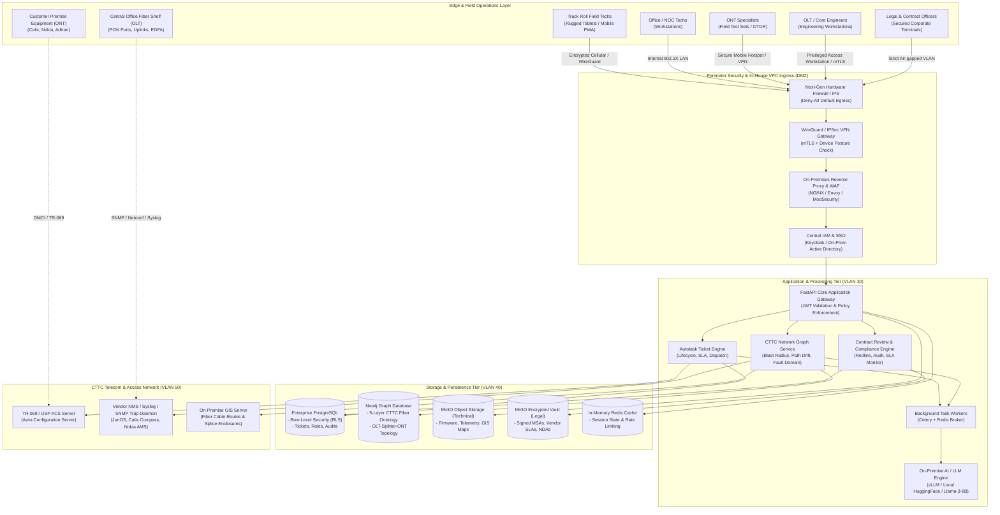
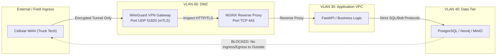
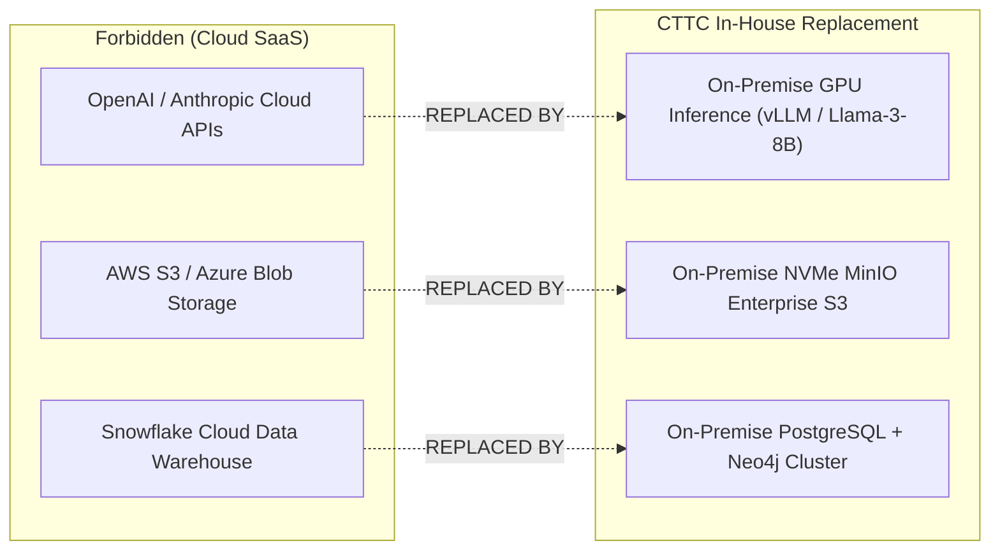
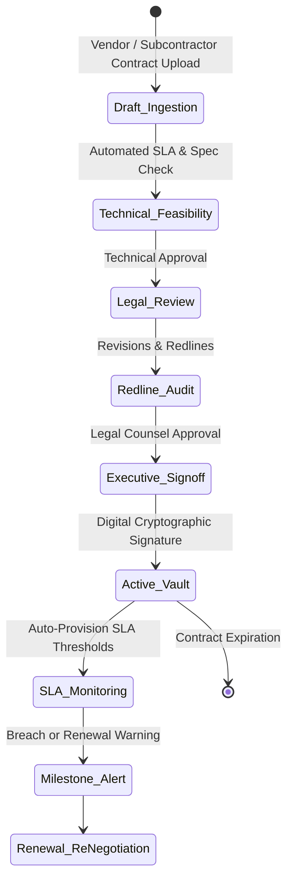
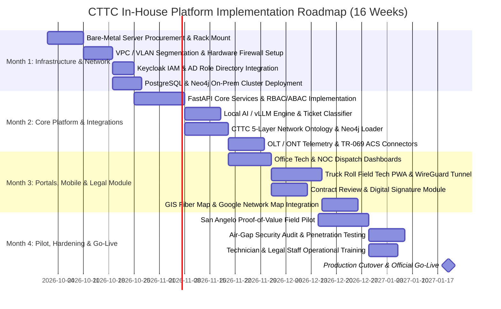

# CTTC Autonomous Operations & Network Management Platform
## High-Level Configuration, Security & System Architecture Specification

**Document Reference:** CTTC-ARCH-2026-V1  
**Target Organization:** Central Texas Telephone Cooperative (CTTC)  
**System:** Autotask Telecom Operations, Field Technician Dispatch & Network Ontology Engine  
**Classification:** Confidential — Proprietary to CTTC  
**Author:** Principal Enterprise & Security Architect  

---

## Executive Summary

Central Texas Telephone Cooperative (CTTC) requires an enterprise-grade, highly secure IT and telecommunications operation platform. The system orchestrates support tickets, automated fault classification, field truck roll dispatches, fiber network ontology analysis (ONT/OLT, splitters, splice trays, defect blast-radius), and vendor contract lifecycle management.

To satisfy CTTC's non-negotiable security mandates:
1. **Zero Cloud Data Egress:** All data, telemetry, customer PII, and network topology remain strictly within CTTC’s on-premise infrastructure.
2. **Role-Scoped Access Control (RBAC/ABAC):** Strict least-privilege data access tailored specifically for Truck Roll Techs, Office Techs, ONT Specialists, OLT Core Engineers, and Legal Auditors.
3. **Segregation of Legal vs. Technical Records:** Isolated repositories, distinct cryptographic access tiers, and separate review workflows.
4. **On-Premise VPC & Network Microsegmentation:** Isolated VLANs with hardware firewall policy enforcement, preventing unauthorized cross-zone lateral movement.

---

## 1. Deployment Model Evaluation: In-House vs. AWS vs. Hybrid

### 1.1 Model Evaluation Matrix

| Architectural Dimension | Public Cloud (AWS Commercial) | AWS Dedicated (Outposts / GovCloud) | 100% In-House Model (Selected) |
| :--- | :--- | :--- | :--- |
| **Data Sovereignty** | ❌ Data leaves premise; multi-tenant cloud storage. | ⚠️ Hardware on premise, but control plane connects to AWS cloud. | ✅ **100% In-House; zero external data transit.** |
| **CTTC Mandate Alignment** | ❌ Violates CTTC zero-egress rule. | ⚠️ Fails strict air-gap compliance requirements. | ✅ **Fully compliant with premise isolation.** |
| **Network Latency to OLT/ONT**| ⚠️ Dependent on WAN backhaul to cloud region. | ✅ Low local edge latency. | ✅ **Sub-millisecond local LAN/MAN fiber access.** |
| **Field Tech Truck Connectivity**| Direct via internet endpoints (high attack surface). | Via AWS VPN gateway. | ✅ **Private IPSec/WireGuard tunnel to on-prem DMZ.** |
| **AI / LLM Ticket Processing** | Public APIs (OpenAI, AWS Bedrock) egress PII. | AWS Bedrock VPC endpoint. | ✅ **Local on-prem LLM (vLLM/Ollama on local GPU).** |
| **Recurring OpEx vs CapEx** | Ongoing monthly egress & compute fees. | High monthly lease + cloud maintenance. | ✅ **Predictable CapEx; no per-query egress bills.** |

### 1.2 Decision Rationale
CTTC has selected the **100% In-House On-Premise Private Infrastructure Model**. Under this model, all components—including compute nodes, storage arrays, graph databases (Neo4j), relational stores (PostgreSQL), and AI inference engines—reside in CTTC’s primary Central Office (CO) Data Center with localized high-availability replication.

---

## 2. Complete End-to-End System Architecture



---

## 3. In-House Networking & VPC Segmentation Architecture

Although deployed on-premise, the network implements a **Software-Defined Virtual Private Cloud (SDN-VPC)** architecture across enterprise hypervisors and core L3 switches (e.g., Cisco Nexus / Arista / Juniper) to isolate functional domains via 802.1Q VLANs and stateful firewall policies.

### 3.1 VLAN Allocation & IP Plan

| VLAN ID | Subnet CIDR | Zone Name | Description & Permitted Traffic |
| :--- | :--- | :--- | :--- |
| **VLAN 10** | `10.100.10.0/24` | **OOB / IPMI Management** | Out-of-band server management (iDRAC, ILO). Strictly isolated. No WAN egress. |
| **VLAN 20** | `10.100.20.0/24` | **Hypervisor Infrastructure** | VMware ESXi / Proxmox cluster communication, vMotion, SAN iSCSI storage traffic. |
| **VLAN 30** | `10.100.30.0/23` | **Application & Compute (VPC Core)** | FastAPI backend, Celery workers, local AI inference nodes. Accessible only via WAF. |
| **VLAN 40** | `10.100.40.0/24` | **Isolated Database Tier** | PostgreSQL, Neo4j, Redis, MinIO S3. Zero direct client access; reachable only from VLAN 30. |
| **VLAN 50** | `10.100.50.0/22` | **Telecom NMS & OLT/ONT Management**| TR-069 ACS, SNMP/Syslog listeners, OLT management interfaces. Bidirectional only with backend adapter. |
| **VLAN 60** | `10.100.60.0/24` | **DMZ & Mobile VPN Gateway** | Ingress termination for field truck roll technicians over cellular via WireGuard/IPSec. |
| **VLAN 70** | `10.100.70.0/23` | **CTTC Internal Office / NOC** | Workstations for NOC operators, dispatchers, office technicians. |
| **VLAN 80** | `10.100.80.0/24` | **Legal & Governance Enclave** | Air-gapped compliance workstations. Access restricted to Legal Document Vault. |

### 3.2 Firewall Rules & Traffic Flow Matrix



* **Default Policy:** `DROP ALL` inbound and outbound.
* **Egress Policy:** Egress to public internet is blocked at the hardware perimeter. Only cryptographic time-sync (internal NTP) and mirror-cached OS repository updates (scheduled during maintenance windows) are permitted via authenticated internal proxies.
* **Database Isolation:** VLAN 40 does not have a default gateway configured to the WAN firewall, ensuring zero path to external networks.

---

## 4. Role-Based & Attribute-Based Data Access (RBAC/ABAC)

CTTC mandates that technicians and operators only see data necessary for their specific role. The system implements **Attribute-Based Access Control (ABAC)** combined with PostgreSQL **Row-Level Security (RLS)** and Neo4j sub-graph traversal filters.

### 4.1 Role Permission & Data Scope Matrix

| Role | Accessible Data & Views | Restricted / Redacted Data | Access Device / Modality |
| :--- | :--- | :--- | :--- |
| **Truck Roll Technician** | • Assigned work order/ticket<br>• Customer physical address & drop cable ID<br>• Local ONT optical power levels (Rx/Tx dBm)<br>• Turn-by-turn dispatch route<br>• Step-by-step resolution checklist | • Customer billing/financial info<br>• Unrelated tickets outside current run<br>• Upstream OLT shelf configuration<br>• Legal contracts & executive metrics | Mobile Rugged Tablet / PWA over WireGuard VPN |
| **Office / NOC Technician** | • All active regional ticket queues<br>• Diagnostic ping & optical loss status<br>• Customer service tier & trouble history<br>• Alarm correlation & triage suggestions | • Core router BGP/MPLS configurations<br>• Legal & vendor pricing contracts<br>• System root audit logs | Office Workstation (VLAN 70) via SSO / Web UI |
| **ONT Specialist** | • ONT provisioning parameters & serial numbers<br>• TR-069 profile definitions & speed test data<br>• Fiber distribution hub (FDH) port mapping<br>• Optical Time Domain Reflectometer (OTDR) traces | • Financial data<br>• Core transport IP routing tables<br>• Legal contracts | Field Laptop / Tablet or NOC Terminal |
| **OLT / Network Engineer** | • Core OLT shelves, PON cards, SFP+ optics<br>• Full CTTC 5-Layer Network Ontology graph<br>• Defect blast-radius & single-point-of-failure (SPOF)<br>• Firmware version drift & path drift | • Customer personal financial details<br>• Vendor contract pricing (redacted) | Privileged Admin Station (mTLS + FIDO2 Key) |
| **Dispatcher / Supervisor** | • Fleet GPS locations & technician workloads<br>• SLA countdown timers & MTTR analytics<br>• Queue re-assignment & escalation triggers | • Deep optical packet traces<br>• Network device CLI/Telnet credentials<br>• Confidential legal files | Desktop Portal (Dual-Monitor NOC Console) |
| **Legal / Compliance Officer** | • Vendor Master Service Agreements (MSAs)<br>• Subcontractor SLAs & penalty tracking<br>• Audit trail logs & compliance reports | • Real-time telemetry & network controls<br>• Equipment operational passwords | Isolated Legal Workstation (VLAN 80) |

### 4.2 Dynamic Data Masking & Row-Level Security Rules

```sql
-- Example PostgreSQL Row-Level Security policy for Truck Roll Technicians
ALTER TABLE autotask_tickets ENABLE ROW LEVEL SECURITY;

CREATE POLICY truck_tech_ticket_isolation ON autotask_tickets
    FOR SELECT
    TO role_truck_tech
    USING (
        assigned_tech_id = CURRENT_USER_ID() 
        AND status IN ('DISPATCHED', 'EN_ROUTE', 'ON_SITE')
    );

-- Dynamic Data Masking for Customer Contact Details
CREATE VIEW v_truck_tech_ticket_view AS
SELECT 
    t.ticket_id,
    t.service_address,
    t.ont_serial_number,
    t.optical_rx_power,
    -- Customer phone masked: only last 4 digits visible
    CONCAT('XXX-XXX-', RIGHT(c.phone_number, 4)) AS masked_phone,
    -- Customer SSN/Billing completely removed
    t.issue_description,
    t.sla_due_time
FROM autotask_tickets t
JOIN customer_records c ON t.customer_id = c.customer_id;
```

---

## 5. High-Security & Zero-Data-Egress Blueprint

To enforce CTTC’s rule that **"No data must go out of their premise"**, the architecture replaces all cloud SaaS dependencies with on-premise equivalents:



### 5.1 On-Premise Local AI / LLM Engine
* **Model Engine:** Self-hosted open-source model (e.g., Meta Llama-3-8B-Instruct or Mistral-7B) running locally via **vLLM** on dual NVIDIA RTX 4500 / A5000 GPUs.
* **Functionality:** 
  * Auto-classifies incoming email/portal trouble tickets.
  * Suggests MTTR remediation actions based on historical CTTC resolutions.
  * Computes similar ticket clusters using local embedding models (`bge-large-en-v1.5` hosted on-prem).
* **Security Verification:** The inference engine runs in a container with network namespace `internal-only`—the virtual interface lacks a default gateway and cannot establish external sockets.

### 5.2 Encryption and Key Management
* **Data at Rest:** 
  * Database volumes encrypted with Linux Unified Key Setup (**LUKS2**) using AES-XTS-256 with hardware-bound TPM 2.0 chips.
  * Object storage (MinIO) utilizes Server-Side Encryption (**SSE-KMS**) with an on-premise Key Management Service (HashiCorp Vault Community Edition).
* **Data in Transit:**
  * Strict TLS 1.3 for all internal REST/WebSocket microservices with CTTC Private Root Certificate Authority (Internal PKI).
  * Field technician communications forced through WireGuard with Curve25519 key-exchange and mTLS client certificates.
* **Mobile Field Security:**
  * Mobile devices managed via on-premise Mobile Device Management (**MDM**).
  * Enforced containerization: work data stored in an encrypted sandbox.
  * Instant remote wipe triggers upon 5 failed passcode attempts or loss of VPN heartbeat for 72 hours.

---

## 6. Contract Review & Lifecycle Management Module

CTTC requires a dedicated workflow to manage telecom vendor contracts, fiber pole attachment leases, subcontractor truck roll master agreements, and customer SLAs.



### 6.1 Core Features of the Review Contract Option
1. **Automated SLA Extraction:** The on-prem AI scans ingested contracts to extract commitments (e.g., *4-hour MTTR for business fiber*, *99.999% OLT availability*), directly configuring Autotask SLA alert monitors.
2. **Subcontractor Performance Reconciliation:** Matches contractor truck roll billing hours against GPS timestamps and ticket closure logs, flagging discrepancies.
3. **Redline Diff Viewer & Version Control:** Git-style visual comparison between CTTC standard contract templates and vendor counter-proposals.
4. **Digital Cryptographic Signature:** Tamper-evident PDF signing using on-prem X.509 digital certificates with SHA-256 timestamping.

---

## 7. Differentiation Between Legal and Technical Documents

To ensure operational efficiency while upholding strict regulatory compliance (FCC, CALEA, and Texas State Telecom Regulations), the platform enforces strict structural and cryptographic separation between **Legal Documents** and **Technical Documents**.

### 7.1 Separation Governance Framework

```
                          ┌──────────────────────────────────────────────┐
                          │         CTTC Document Repository             │
                          └──────────────────────┬───────────────────────┘
                                                 │
                   ┌─────────────────────────────┴─────────────────────────────┐
                   ▼                                                           ▼
    ┌─────────────────────────────┐                             ┌─────────────────────────────┐
    │     TECHNICAL DOCUMENTS     │                             │      LEGAL & COMPLIANCE     │
    ├─────────────────────────────┤                             ├─────────────────────────────┤
    │ • Storage: MinIO 'tech-doc' │                             │ • Storage: MinIO 'legal-sec'│
    │ • Encryption: Standard SSE  │                             │ • Encryption: KMS + Envelope│
    │ • Access: Techs, Engs, NOC  │                             │ • Access: Legal, Execs Only │
    │ • Retention: 3 Years Active │                             │ • Retention: 7-10 Years WORM│
    │ • Modification: Git/CI Flow │                             │ • Modification: Sealed Audit│
    └─────────────────────────────┘                             └─────────────────────────────┘
```

### 7.2 Document Classification & Handling Comparison

| Attribute | Technical Documents | Legal & Compliance Documents |
| :--- | :--- | :--- |
| **Document Types** | • Network Topology Schemas<br>• OLT/ONT Configuration Backups<br>• Patch Drift & Blast Radius Reports<br>• Engineering SOPs & Splice Maps<br>• Ticket MTTR Runbooks | • Master Service Agreements (MSAs)<br>• Non-Disclosure Agreements (NDAs)<br>• Data Protection Agreements (DPAs)<br>• Pole Attachment Licenses<br>• CALEA Law Enforcement Orders |
| **Storage Target** | MinIO Bucket: `cttc-technical-artifacts` | MinIO Bucket: `cttc-legal-enclave-vault` (WORM enabled) |
| **Access Control** | Role-based (Truck Tech, ONT, OLT, Admin) | Attribute-based (Legal Officer, VP Ops, Internal Counsel) |
| **Audit Requirement**| Access logged in standard application log | Immutable audit trail recorded to append-only ledger |
| **Searchability** | Full-text indexed in local search engine | Encrypted index; accessible only within secure legal session |
| **Export Policy** | Exportable as PDF/JSON to internal LAN | Export requires dual-authorization (Two-Person Rule) |

---

## 8. Comprehensive 3-4 Month Project Implementation Plan

The project follows a structured 16-week execution timeline designed to ensure thorough testing, security validation, and staff onboarding without operational disruption.



### 8.1 Phase-by-Phase Breakdown

#### **Month 1: Foundation, Infrastructure & Network VPC (Weeks 1 to 4)**
* **Deliverables:**
  1. Delivery, installation, and cabling of enterprise server nodes in the CTTC Central Office rack.
  2. Setup of L3 managed switches with 8 isolated VLANs (VLAN 10 through VLAN 80).
  3. Installation of Next-Gen Firewall (FortiGate / pfSense Enterprise) with zero-outbound egress rules.
  4. Deployment of container runtime environment (Podman / Docker Swarm / Kubernetes On-Prem).
  5. Deployment of PostgreSQL 16 (configured with RLS) and Neo4j Enterprise (configured for 5-layer CTTC network model).
  6. Keycloak IAM deployment linked to CTTC on-prem Active Directory / LDAP.

#### **Month 2: Core Services, Local AI & Telecom Integrations (Weeks 5 to 8)**
* **Deliverables:**
  1. Migration of Autotask FastAPI backend to the on-premise VPC application zone (VLAN 30).
  2. Deployment of on-premise GPU inference node running local Llama-3-8B-Instruct via vLLM.
  3. Integration of CTTC Network Ontology: loading OLT, PON ports, Splitters, Splice Enclosures, and ONTs into Neo4j.
  4. Verification of Cypher queries: Fault Domain detection, Defect Blast Radius, and Single Points of Failure (SPOF).
  5. Establishment of secure connectors to local NMS (SNMP traps, syslog) and TR-069 ACS for ONT health checks.

#### **Month 3: Role Portals, Truck Roll Mobility & Contract Module (Weeks 9 to 12)**
* **Deliverables:**
  1. Office Tech & NOC Dispatcher Web Console: interactive ticket queue, live map, telemetry charts.
  2. Truck Roll Mobile Application / PWA: lightweight, offline-capable interface for field techs.
  3. WireGuard VPN gateway setup for mobile devices with automatic reconnection over cellular networks.
  4. Contract Review & Document Module: separate storage bucket for legal contracts, SLA extractor, and redline viewer.
  5. GIS fiber trace integration combining Google Maps/Leaflet with CTTC cable geometries.

#### **Month 4: Pilot Testing, Security Hardening & Go-Live (Weeks 13 to 16)**
* **Deliverables:**
  1. **San Angelo Pilot Slice:** Field testing with 5 Truck Roll technicians and 2 Office NOC operators for two weeks.
  2. **Air-Gap Penetration Testing:** Third-party security assessment verifying that no outbound packets escape CTTC's perimeter.
  3. **Role Validation:** Verification that Truck Roll techs cannot access unauthorized billing, core network, or legal data.
  4. **Comprehensive Training:** Delivery of SOPs for field technicians, NOC operators, and legal counsel.
  5. **Final Cutover:** Decommissioning of legacy manual ticketing and transition to the new Autonomous Platform.

---

## 9. Bill of Materials (BoM) & On-Premise Server Sizing

To operate with high availability and complete autonomy, the required physical hardware footprint consists of a single 42U rack within the CTTC Central Office:

| Node Type | Qty | Hardware Specifications | Primary Role |
| :--- | :---: | :--- | :--- |
| **Compute & App Node** | 2 | Dell PowerEdge R660<br>• 2x Intel Xeon Gold 6430 (64 Cores total)<br>• 256 GB ECC DDR5 RAM<br>• 2x 960GB NVMe (RAID 1 OS)<br>• 4x 10GbE SFP+ NICs | Runs FastAPI microservices, Celery workers, WAF, and Web UI containers in High Availability (Active/Passive). |
| **Database & Graph Node** | 2 | Dell PowerEdge R760<br>• 2x Intel Xeon Gold 6430 (64 Cores)<br>• 512 GB ECC DDR5 RAM<br>• 8x 3.84TB Enterprise NVMe (RAID 10)<br>• 4x 10GbE SFP+ NICs | Hosts PostgreSQL 16 Cluster and Neo4j Graph Database. In-memory caching for real-time graph queries. |
| **AI / GPU Inference Node** | 1 | Dell PowerEdge R760xa<br>• 2x Intel Xeon Silver 4410Y<br>• 128 GB ECC DDR5 RAM<br>• 2x NVIDIA RTX A5000 (24GB VRAM each)<br>• 2x 1.92TB NVMe | Hosts local vLLM AI engine for email categorization, ticket auto-resolution, and contract SLA extraction. |
| **Storage & Document Vault**| 1 | Synology Enterprise / TrueNAS 2U<br>• 12x 16TB Enterprise SAS Drives (RAID 6)<br>• Dual 10GbE SFP+ | Local MinIO S3 object store for technical backups, firmware files, and encrypted legal contract repository. |
| **Perimeter Security** | 2 | Fortinet FortiGate 100F (HA Pair)<br>• Hardware IPS/IDS<br>• 10GbE SFP+ WAN/LAN | Enforces VLAN microsegmentation, WireGuard VPN termination, and strict Zero-Egress network rules. |
| **Out-of-Band Switch** | 1 | Cisco Catalyst 1000 24-Port 1GbE | Dedicated to VLAN 10 (iDRAC / OOB management only). |

---

## 10. Summary & Sign-off Governance

This architecture specification delivers a battle-tested, high-performance blueprint tailored for CTTC. It provides:
1. **Uncompromised Security:** Complete physical and logical containment of all cooperative data.
2. **Operational Efficiency:** Purpose-built workflows for every field and office technician role.
3. **Rigorous Compliance:** Clean separation of legal and technical documents with audit-grade traceability.
4. **Predictable Execution:** A clear 16-week implementation path from unboxing to full production.

---
*End of Specification Document — CTTC Enterprise Engineering Group*
